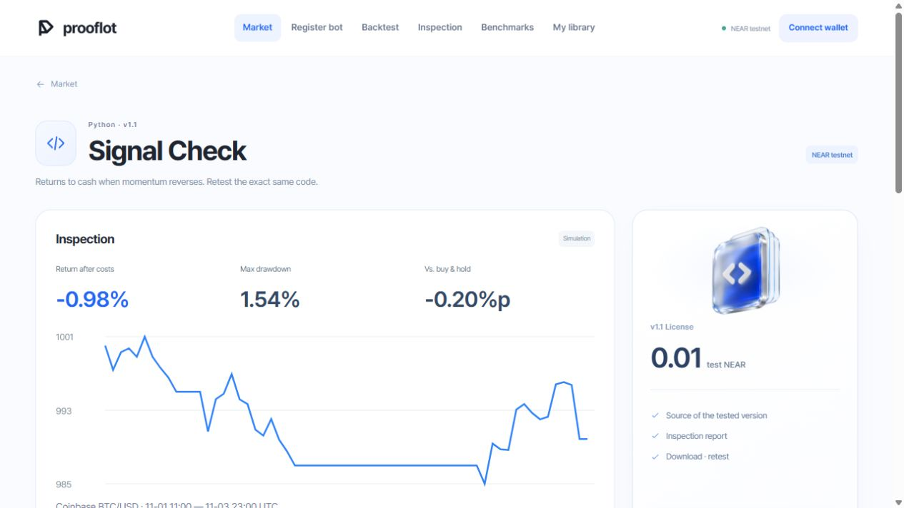

# Prooflot

Upload a trading bot, inspect a backtest, and buy the exact tested version on NEAR testnet.

The product supports creator-owned **Python code**, **rule configurations**, and optional **NEAR AI prompts**. Creators register immutable versions, run tests, review measured checks, and set a license price. Buyers inspect the report, purchase, download the pinned source/config and retest it. The English UI leads with measured results and purchase terms.

Prooflot was developed under the working names AgentProof and BotPassport. Existing report schemas, contract identifiers and historical evidence keep their original names so their hashes and transaction references remain verifiable.

**[Watch the 89-second product demo](https://youtu.be/OEni-eWBdwk)** · **[Public hackathon demo post on X](https://x.com/AlphaGgang/status/2121637337587458332)**

## Judge quick start

**[Creator-to-buyer walkthrough](docs/judge-guide.md)** · **[Final real testnet workflow](docs/final-wallet-evidence.json)** · **[Saved package verification](docs/final-download-evidence.json)**

The UI is in English. A fresh clone supports a complete local creator, inspection, listing, purchase, file-save and retest flow without a wallet. Actual NEAR testnet evidence can be independently checked with the commands below. Local simulations and real testnet transactions are labeled separately.

## Run

Node.js 24.x (tested 24.22.1), then:

~~~sh
npm ci
npm run build
npm start
~~~

On this prepared Windows workspace, run **start.ps1**. Korean quick start and account/key instructions: [docs/start.ko.md](docs/start.ko.md). Open http://127.0.0.1:4317. Localhost only; not a hosted public service. SQLite data and keys live under the Git-ignored data/ directory. Rules and synthetic examples need no API key. Python execution requires Docker Desktop and this pinned image:

~~~sh
docker pull python:3.12-slim-bookworm@sha256:935c3c5b12357a7e10caa9c1e6ca5692344d97cf229832ef584be2cec9fc03df
~~~

## Four fixed public tests, committed before execution

Open **Benchmarks**. A listed Python/rule bot (or free Atlas example) runs on BTC/USD and ETH/USD, October 19–25 and November 2–8, 2026 UTC. Four 168-candle datasets, 628 decisions in total; every case starts with $1,000 cash, 10 bps fees and 5 bps slippage. Eleven hours per case warm up the observation; the terminal unfillable decision is explicit. These are public historical windows, not unseen holdouts.

The server first freezes inputs and waits for a FINAL NEAR manifest commitment, then executes all four cases. Every started attempt, including failures, remains in the local public history. The aggregate report is committed and checked against FINAL state. Local-only setups show no chain verification badge. The application disallows dropping unfavorable cases or changing protocol costs. SQLite append-only rules are not protection from a malicious database administrator; the on-chain commitment protects the identifiers once published. Results still rely on the operator's execution and market-data collection.

**Check the shipped real Python evidence without a wallet, server or API key:**

~~~sh
node scripts/check-benchmark-proof.mjs
~~~

With the local server running, create a new standard test:

~~~sh
node scripts/verify-benchmark.mjs
# To select a public Python bot (requires Docker):
node scripts/verify-benchmark.mjs --python
~~~

Public benchmark funding and report attestation use development/operator accounts and test tokens. Personal creator listing and buyer payment transactions use external-wallet signing requests. The new actual Python run completed all 628 decisions and 17 fills: returns −1.19%, −1.20%, −5.02%, +0.74%. Completing the protocol is not evidence of profitable trading.

[Objective contest review](docs/release-review.ko.md) · [public benchmark proof](docs/benchmark-evidence.json)

## Compare before buying

From the market, click **Compare two bots** for a free two-example run. Or select 2–3 Python/rule/example bots, open **Compare**, import the BTC sample and run them under the same frozen data, costs and capital. Every result is a fresh execution. Interrupted or invalid results are not labeled comparable. Paid prompt inference is excluded.

Open a product to see measured returns, fills, sample limitations, three subperiod returns, and 1×/2×/3× cost scenarios. Cost scenarios replay saved decisions; they are not fresh bot executions or holdout validation. Additional assessments have their own hash and preserve the original report. **Verify on NEAR** reads FINAL listing/job state without signing a transaction.

[Winner research and implemented changes](docs/winner-benchmark.ko.md) · [actual BTC comparison evidence](docs/comparison-evidence.json)

## Try the product

1. **Connect wallet**: select a testnet account in Meteor or Nightly, then click **Sign in wallet** to open the NEP-413 request. Unlock the wallet in its own UI. No private key or seed phrase is sent to the app. The wallet owns subsequent creator versions and purchases.
2. **Register bot**: upload Python code, a rule configuration or an optional AI prompt. Confirm source rights. Registration freezes the exact artifact; edits require a new version.
3. **Backtest**: use synthetic examples, a CSV, or 72 closed Coinbase BTC/USD candles (November 1–3, 2026 UTC). Review results, fees, drawdown, warnings and the same-window baselines. Only completed valid creator reports may be listed.
4. **Publish listing**: set 0 < price <= 0.5 test NEAR. The creator wallet approves version/job registration and listing creation. The operator only attests/settles the report. Initial deposits total at most 0.08 test NEAR plus gas; unused amounts become withdrawable credit.
5. **Review purchase → Buy with wallet**: review the report and exact version. The buyer signs price + 0.02 test NEAR storage allowance, plus gas. FINAL chain state gates the entitlement. Rejected or mismatched transactions do not unlock source.
6. **My library**: download a ZIP with source, original artifact, license, inspection report, checksums and a standalone offline verifier; retest the exact purchased version in a fresh execution. Sign in with the same wallet in a new browser session to recover existing licenses without paying again.
7. **Withdraw to wallet**: the creator withdraws sale proceeds and unused deposits with a wallet-approved call.

First visit opens a full-screen, 13-second product introduction: register a bot, inspect its actual example report, then buy/download/retest. A continuous glass object, animated report curve and license card connect the scenes. The original localStorage preference is preserved for returning visitors. Skip, pause, chapter selection, replay, keyboard operation and reduced motion are supported. Open [the introduction](http://127.0.0.1:4317/?intro=1) to replay without clearing storage. The geometric P logo is distinct from the official NEAR mark. See [visual asset credits](docs/assets.md).

The market, creator studio, inspection report, product, checkout and purchased-bot library share the introduction's local typeface, cobalt palette and glass asset. Intro CTAs transition directly into the market or studio. Registration begins with a file upload and a live name/version preview; detailed guidance is expandable. Reports retain measured checks and visible warning titles. Checkout separates the exact license price, 0.02 test NEAR storage allowance and additional gas. Already owned versions lead to the library instead of another purchase. See [product UI verification](docs/product-ui-evidence.json).

Python containers have no host mounts or network, a read-only root, non-root UID, dropped capabilities and resource/time/output limits. Docker unavailability fails closed. This is not an independently audited multitenant sandbox.

## Actual NEAR integration

Contract: [agentproof-060206eead.testnet](https://testnet.nearblocks.io/address/agentproof-060206eead.testnet).

~~~sh
# Public read-only verification, no server/wallet/private key:
node scripts/check-wallet-proof.mjs
node scripts/check-meteor-proof.mjs
node scripts/check-benchmark-proof.mjs docs/wallet-benchmark-evidence.json

# Create your own development operator contract on Windows:
npm run testnet:setup
# With the server running, test the entire signed workflow:
npm run testnet:wallet
~~~

Personal wallets use pinned NEAR Connect 0.12.0 and locally snapshotted Meteor/Nightly executors. NEP-413 authentication binds a one-use five-minute nonce to the browser session, account and origin, and checks a FINAL FullAccess key. Twelve-hour sessions map to a stable testnet account identity. Download and money-moving preparation recheck the key; logout revokes the session. The normal HTTP API no longer offers developer-shared buyer signing.

Creator and buyer transactions are prepared unsigned. The server checks final contract state and, when supplied, exact transaction signer, receiver, method, deposit, gas and arguments. Interrupted publication resumes missing steps. An already recorded buyer license can be reconciled without re-paying. The operator attests report hashes and settles the test service deposit with zero charge; benchmark funding remains developer-sponsored.

Actual separate test creator/buyer accounts completed 14 workflow checks: Python upload, inspection, publication, forged/mismatched request rejection, purchase, duplicate rejection, entitlement isolation, exact source download, cross-session recovery, fresh retest and creator withdrawal. ZIP access/contents are separately verified. Public proof: [wallet-testnet-evidence.json](docs/wallet-testnet-evidence.json), [product report](docs/wallet-product-evidence.json), [ZIP verification](docs/wallet-download-evidence.json). The new wallet-owned Python benchmark completed 628 decisions and 42 fills across four cases: −1.74%, −0.34%, −4.96%, +2.02%.

**Actual Meteor Web purchase:** the user prepared and unlocked nearblog6709.testnet. The browser flow completed NEP-413 login, a 0.03 test NEAR purchase request, FINAL license confirmation, ZIP download and a fresh 61-decision Python retest. [Purchase receipt](https://testnet.nearblocks.io/txns/5okSTWEwmR7BR8Yzao1uV5R1sT4LHrbBvtoKoK6Nt92L), [16 recorded checks](docs/meteor-wallet-evidence.json); the independent public verifier passes 10 chain checks. The ZIP's exact source/version/report/buyer match, and the new execution reproduces −0.98%, 1.54% drawdown and five fills.

The Meteor adapter now supplies the host app URL instead of about:srcdoc. Its compatibility patch and upstream/served hashes are recorded in docs/wallet-adapters.json; a distinct cache version prevents stale first-load code. New signing requests start from an explicit app button, so a completed popup does not have to launch the next one automatically. The initial 0.1 test NEAR balance was insufficient for Meteor's transaction balance check; funding to 0.5 allowed this test purchase.

**Verification boundary:** creator publication/withdrawal and adversarial cases were tested with separate SDK keys encrypted in data/wallet-test-keys.dpapi, never read by the application server. The real Meteor UI verification covers the personal buyer path; creator UI approvals and the Nightly extension remain unverified. No personal wallet key or recovery phrase was read by the agent or app.

Setup uses Windows CurrentUser DPAPI for the development operator credentials. No private keys, source or raw API response is posted on-chain. Report truth and usage remain operator-attested; hashes establish identity and purchase state, not independent execution truth or trading quality.

The older testnet:verify command and testnet-evidence.json preserve a legacy developer-signing regression workflow; use testnet:wallet for the current personal identity and payment architecture.

## Contract build

Run scripts/build-contract.ps1 on Windows with Docker Desktop. The script uses a digest-pinned Rust 1.95.0 image, near-sdk 5.30.1, Cargo.lock and contracts/.cargo/config.toml. The target-specific **--cfg near** flag is required by this SDK for host panic/hash functions. Omitting it produced opaque WASM traps during early testing; the deployed build includes the fix.

With Rust 1.95+ on another system:

~~~sh
cd contracts
rustup target add wasm32-unknown-unknown
cargo test --locked
cargo build --locked --target wasm32-unknown-unknown --release
~~~

## Tests

~~~sh
npm test
~~~

Set RUN_DOCKER_TESTS=1 to include the real container isolation test. Verified locally: **84 JavaScript/SQLite/HTTP/Docker tests**, **10 previously verified Rust tests**, **14 separate-account live workflow checks**, and **14 public wallet proof checks**. Counts distinguish local logic, NEAR VM unit tests and real chain checks; they are not a security certification. See docs/verification.md.

The budget fixture remains available: Atlas, 84 candles, $0.24 virtual budget stops at 17/73 decisions, reserves before each call and retains unresolved liabilities. LLM transport/usage is tested with a mocked response. **No paid/live LLM inference has been performed in this session.**

## Optional AI key

Rules and Python bots do not need an LLM. A prompt bot asks the chosen model to return BUY/SELL/HOLD at every historical step.

Create a NEAR AI Cloud account, add credits and create an API key at https://cloud.near.ai. Run scripts/configure-ai.ps1 in your own terminal. It lists official model metadata, reads the key without echo, asks you to approve a budget and estimated-cap behavior, and saves an encrypted DPAPI file. It sends no inference. Restart start.ps1 and register a prompt bot using the exact configured model ID. Do not paste keys into chat or commit them.

Provider hard billing bounds are unverified. Strict live mode stays disabled; estimated live mode needs explicit opt-in. Timeouts retain reservations, actual usage settles once, and overrun halts new work. Model revision and TEE attestation are not verified. The optional API uses NEAR AI directly, with no OpenAI SDK dependency.

## Scope and evidence

- Single-asset long/flat paper trading; next-open fills, exact integer money, fees/slippage. No order-book liquidity, leverage, exchange order execution or real-money custody.
- CSV source rights and historical completeness are not independently audited. Coinbase sample is fetched locally and excluded from the source archive. API reference: https://docs.cdp.coinbase.com/api-reference/exchange-api/rest-api/products/get-product-candles.
- Fixed-decision replay is deterministic. A fresh Python process/LLM call is a new test and may differ for a stateful or nondeterministic bot. Pretrained/hardcoded future information cannot be ruled out.
- Source is withheld from public catalog/run/report responses and delivered after session entitlement. Once downloaded, software cannot be made uncopyable by a chain license.
- Anonymous sessions support local exploration. Wallet-authenticated sessions own private creator records and paid licenses. Independent sandbox hardening, creator-wallet UI and Nightly approval QA, production recovery at scale and billing remain work. The Meteor buyer approval was tested separately.
- Hackathon submission copy and current rules/competition comparison are in docs/submission-pack.ko.md. The application runs locally. The public repository contains reproducible instructions and independent chain verifiers. The captioned video shows the real local flow and live verification of previously recorded testnet evidence.

Code license: MIT. User bot license terms apply to separately registered creator artifacts; they do not remove MIT rights from bundled examples.

## Track fit

**Open Innovation:** a marketplace where an inspected, versioned software artifact is the unit of ownership. **Agent Economy:** creator commerce and purchase infrastructure for reusable bots. The current purchasing decisions are human-directed; autonomous agent-to-agent negotiation is not implemented. NEAR provides version/terms-bound licenses, sale credits and withdrawals, while off-chain execution remains operator-attested.

## Hackathon provenance and dependencies

Built for NEAR HACKATHON, November 10–14, 2026, by KYUMIN KIM (one-person team), with Codex assistance for implementation, research, debugging and verification. This repository contains the new Prooflot product (formerly BotPassport); no pre-hackathon application baseline or UI template was imported. Earlier BotPassport/AgentProof names remain in immutable schemas and the deployed contract.

Dependencies are pinned in package-lock.json and Cargo.lock: near-api-js 7.4.0, NEAR Connect 0.12.0, esbuild 0.28.2 and near-sdk 5.30.1. Wallet adapters are snapshotted with upstream hashes in docs/wallet-adapters.json. Python/Rust container images are digest-pinned. Pretendard is bundled under its included license. Decorative glass images were generated with OpenAI ImageGen; logos, charts, layouts and animations are implemented as code. Asset provenance is in docs/assets.md.

Python and rule bots do not need an LLM. The optional NEAR AI adapter was tested with mocked transport; no live paid inference is claimed. The product is a bot research-license marketplace, not an autonomous fund manager.

## Package

Run scripts/package.ps1 to create output/prooflot-testnet-mvp.zip. It includes sources, locked dependencies, the built WASM, pinned wallet adapters/browser bundle, generated decorative asset, screenshots and public evidence. Runtime data, keys, node_modules and discarded images are excluded.
