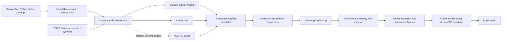

# Architecture

## Modules

| File | Responsibility |
| --- | --- |
| src/bots.mjs | Immutable creator versions, source redaction, owner checks, frozen CSV datasets. |
| src/bot-runner.mjs | Rule execution; non-root, networkless Docker Python with resource/time/output limits. |
| src/data.mjs / market-data.mjs | Synthetic fixtures and fixed Coinbase BTC/USD import; closed-candle observations. |
| src/engine.mjs | Integer accounting, next-open fills, fees/slippage, common-window baselines. |
| src/inspection.mjs | Measured pass/warn/fail checks; invalid or unresolved runs cannot sell custom bots; partial completion is a warning and must be disclosed. |
| src/compare.mjs | Owner-scoped 2–3 bot executions; frozen common profile, full completion/window checks, no paid prompt inference. |
| src/assessment.mjs | Separate hashed evidence/sample disclosures, saved-decision cost scenarios and contiguous subperiod returns. Original reports stay immutable. |
| src/store.mjs / service.mjs | SQLite transactions, immutable reports, usage reservations, execution/replay/retest. |
| src/providers.mjs | Budget fixture and optional NEAR AI HTTP transport. Live inference remains unverified. |
| src/market.mjs | Creator-only listing and separate local demonstration entitlements. |
| src/near.mjs / chain-market.mjs | Read-only testnet access, operator signing and final listing bindings; legacy development workflow kept for regression. |
| src/wallet-auth.mjs / wallet-market.mjs | NEP-413 ownership, staged unsigned creator transactions, buyer license reconciliation, credits and withdrawal requests. |
| src/artifact-download.mjs | Fixed-name ZIP32 of the entitled source, terms and report, with CRC-32. |
| public/wallet-entry.js / onboarding.js | Local wallet connector bundle, recovery UI, first-visit introduction and replay. |
| src/secrets.mjs | Windows CurrentUser DPAPI for local development keys and optional AI settings. |
| src/server.mjs | Loopback API, same-origin/CSRF checks, session ownership, entitlement-gated downloads. |
| contracts/src/lib.rs | NEAR versions, escrow/jobs, result commitments, listings, licenses and credits. |

## Identity and entitlement

A version hashes its source/config, owner identity, runtime and terms. Reports redact source. Local sessions are anonymous; a wallet authenticates with a one-use NEP-413 challenge bound to account, origin, browser session and expiry. The backend verifies the signature and a FINAL FullAccess key on testnet. Stable wallet:testnet:account identities persist across browser sessions without sharing cookies. Download, publication and purchase preparation recheck key authority.

The creator wallet registers the version and funds the pinned evaluation job in one transaction. The operator commits the existing completed report and settles the service deposit with zero charge. The creator wallet creates the price/version/report/terms-bound listing. Prepared listings stay outside the public listings table until FINAL confirmation; resuming checks chain state and only requests missing actions.

The buyer wallet signs price plus storage allowance. The server validates FINAL listing state and the authenticated buyer's exact on-chain license. Supplied receipts must match signer, receiver, action count, method, gas, deposit and arguments. Reconciliation may instead read the existing FINAL license, so a lost callback does not require another payment. Stable owner/listing uniqueness prevents duplicate local entitlements. Unused storage deposits and seller proceeds become contract credits; a wallet-approved withdrawal pays them out.

Purchased ZIPs include bot.py (Python), bot.json, license.json, report.json and README.txt. Fixed names prevent uploaded-path traversal. The JSON artifact endpoint remains available. Both require the authenticated entitlement. Once downloaded, source can be copied; the chain does not provide DRM.

The app never reads the separate test-client keys. Operator/benchmark keys are development infrastructure. External wallet UI approval is still a manual verification boundary; the real testnet workflow was exercised by separate SDK signing accounts.

## Causality and execution

Only closed candles through time t enter the observation. A decision fills at the next candle's open with fees/slippage; the final unfillable decision is marked. Agent, cash and buy-and-hold share the completed interval. Fixed-decision replay reproduces execution; a fresh run can differ for nondeterministic or stateful bots. Hardcoded future information and model-training leakage cannot be detected by restricting observations alone.

Python runs in a digest-pinned image, no network or host mounts, read-only root, non-root UID, dropped capabilities and no-new-privileges, with CPU/memory/PID/time/output bounds. Missing Docker fails closed. Containers are not a complete malware audit. No creator API key enters the container.

## Accounting and trust

Meteor Web popup metadata uses the app URL supplied by the sandbox bridge, not the iframe's about:srcdoc URL. scripts/wallet-compat.mjs records a single checked source substitution; docs/wallet-adapters.json stores both upstream and served hashes. The manifest cache version includes the served digest. Login signatures and each payable action start from an explicit app button, since activation in a previous popup does not carry over to the host window. Wallet diagnostics record stage labels only, excluding challenges, signatures and credentials.

Before each paid-model call, SQLite BEGIN IMMEDIATE enforces settled + reserved + unreconciled + next reservation <= approved run budget and daily budget. Timeouts retain liabilities and are not retried automatically. Strict live caps remain unavailable because provider billing bounds are unverified. Rules/Python make no LLM calls and cost zero in the model ledger.

Testnet service deposits, storage deposits and credits are separate. Withdrawals clear credits before transferring and restore them once after a failed private callback. Reports and usage are operator-attested. On-chain hashes prove content identity and purchase state, not truthful execution, investment quality or future profitability.

The server is localhost-only. Wallet ownership and transaction reconciliation are implemented for the loopback prototype. Public hosting still requires hardened tenant isolation, operational recovery at scale, operator/data-source policies and independent security review.

## Public fixed benchmark (2026-11-13)

The benchmark-data module pins four public Coinbase asset/window cases and one cost protocol. It validates all hours and OHLC before freezing its own snapshot cache; arbitrary user upload labels cannot replace these inputs. Each attempt receives fresh runs on content-identical snapshots. Reports retain their original engine hashes.

The benchmarks module records append-only attempts and events. All inputs are frozen before execution. In testnet mode, benchmark-chain waits for the shared signing queue and FINAL fund_job commitment before any provider call. Result commitment includes every case, including failed or incomplete ones. Commitment failure prevents execution. Restart marks unfinished attempts interrupted and never retries. A final-chain failure leaves an unverified result, not a completed badge.

The existing job contract records the suite manifest, version, aggregate result and decision counts; no contract upgrade was needed. The development tariff for this free public evaluation is zero and the service deposit is credited back through existing settlement. Storage and gas still use test tokens. No aggregate portfolio return or unseen-holdout claim is made.

Public API: GET/POST /api/benchmarks; GET /api/benchmarks/:id; GET /api/benchmarks/:id/evidence; POST /api/benchmarks/:id/verify-chain. Creation accepts only a public listed version or a built-in free example plus explicit public-results consent. Prompt bots are excluded. Own runs/comparisons cannot overlap the suite; public evidence withholds source and free-text rationale.

Append-only SQLite triggers do not protect against a malicious operator replacing the database. There is no global on-chain attempt enumeration or independent execution attestation. The read-only check-benchmark-proof script needs no credentials and checks the saved identifiers against FINAL state.

Benchmark result schema v2 distinguishes filled trades (`fills`, equal to metrics.trades) from all order-attempt records (`order_attempts`). The initial v1 summary included the terminal unfilled record in its fills field. That immutable history is retained in the v1 evidence files; the UI reads metrics.trades for either schema. A new v2 Python attempt supersedes the initial summary in the main evidence document.
